# Microsoft Intune Endpoint Management Lab

Hands-on Microsoft Intune lab demonstrating Windows 11 device enrollment, compliance policies, application deployment, endpoint security, and IT troubleshooting.

---

## Overview

This project simulates an enterprise IT environment using **Microsoft Intune** and **Microsoft Entra ID** to manage Windows 11 endpoints.

The goal is to gain hands-on experience with cloud-based device management, security policies, application deployment, Windows updates, and IT troubleshooting.

The lab reflects common responsibilities of **IT Support Technicians**, **Help Desk Analysts**, and **Endpoint Administrators**.

---

## Technologies Used

- Microsoft Intune
- Microsoft Entra ID
- Windows 11 Enterprise
- Oracle VirtualBox
- Microsoft Defender
- Windows Update for Business

---

## Lab Environment

| Component | Details |
|---|---|
| **Host** | Windows PC |
| **Virtualization** | Oracle VirtualBox |
| **Endpoint** | `INTUNE-WIN11-01` (Windows 11 Enterprise) |
| **Device Management** | Microsoft Intune |
| **Identity Management** | Microsoft Entra ID |

---

## Project Objectives

## 1. Windows VM and enrollment

Configured a Windows 11 Enterprise evaluation VM with virtual TPM 2.0, UEFI, and Secure Boot. Enrolled the device into Intune and confirmed its presence in Company Portal and the admin center.

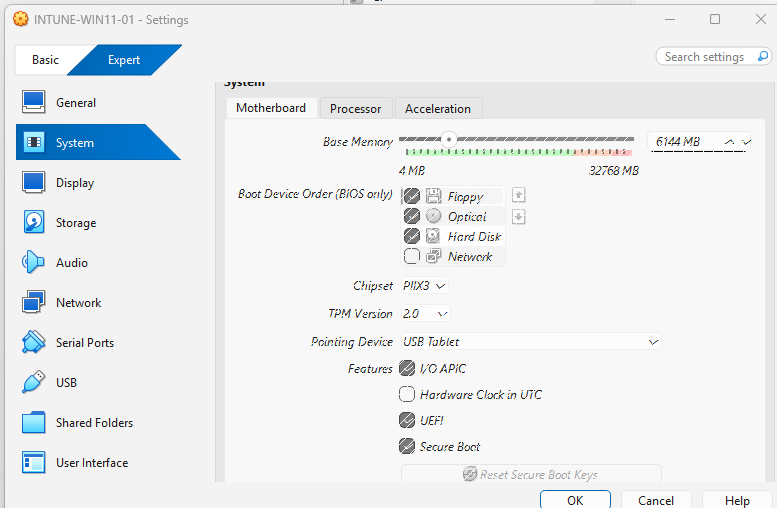
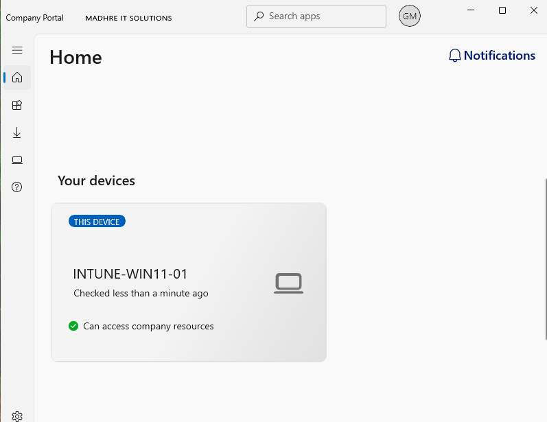

## 2. Device groups and compliance

Created a pilot Microsoft Entra security group for targeted management. Configured a Windows 11 compliance policy and verified the device reported **Compliant**. Updated Microsoft Defender security intelligence and verified Company Portal device access.

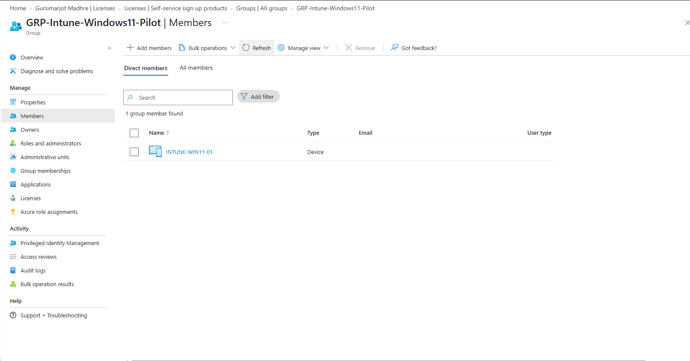

The compliance test also documented a device access issue and its remediation after updating Microsoft Defender security intelligence.

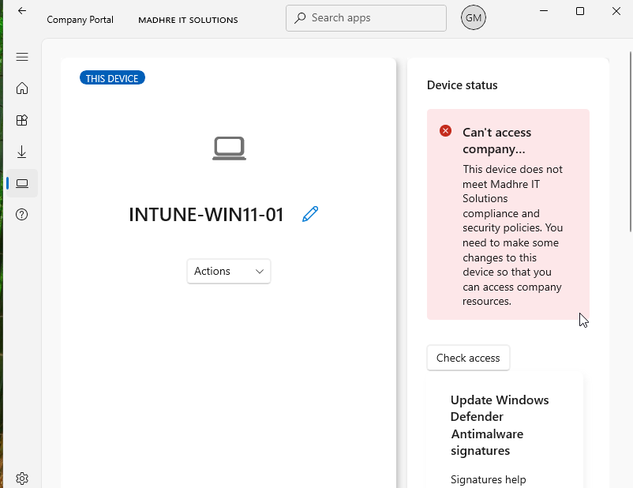
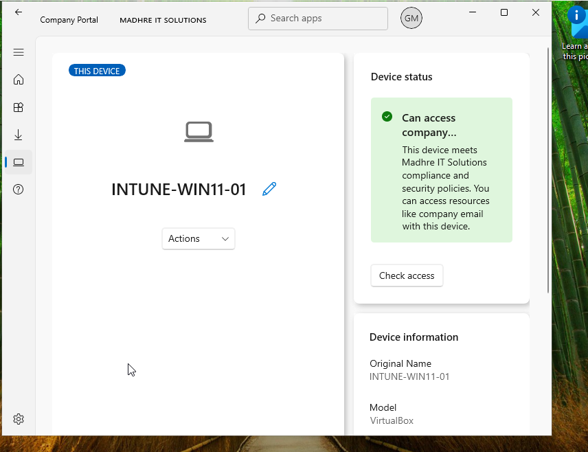

## 3. Application administration

Created and targeted a Microsoft Store application assignment. Prepared a **7-Zip Win32** package with Microsoft's Win32 Content Prep Tool and configured silent installation, uninstall commands, architecture requirements, a file-based detection rule, and a Required assignment to the pilot group.

These screenshots demonstrate **application packaging and deployment configuration**.

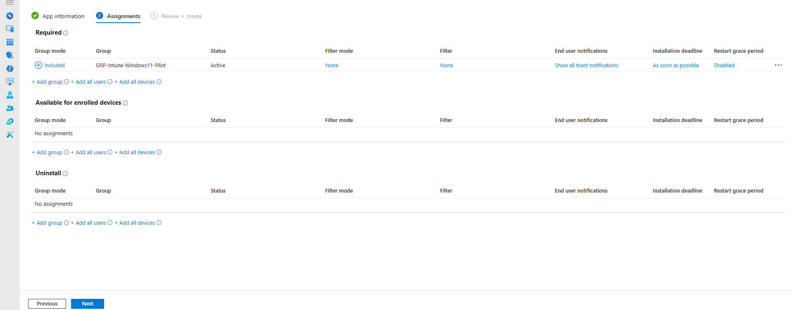
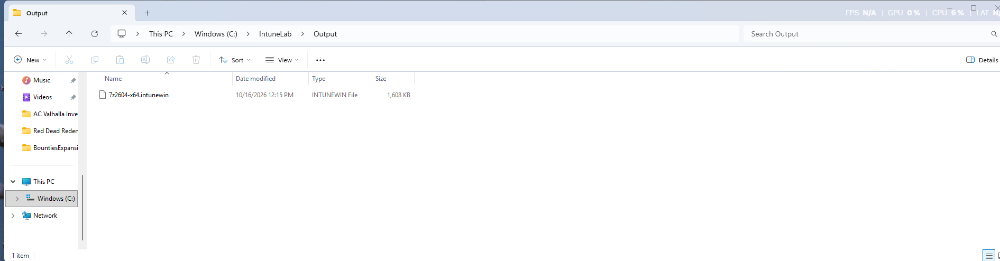
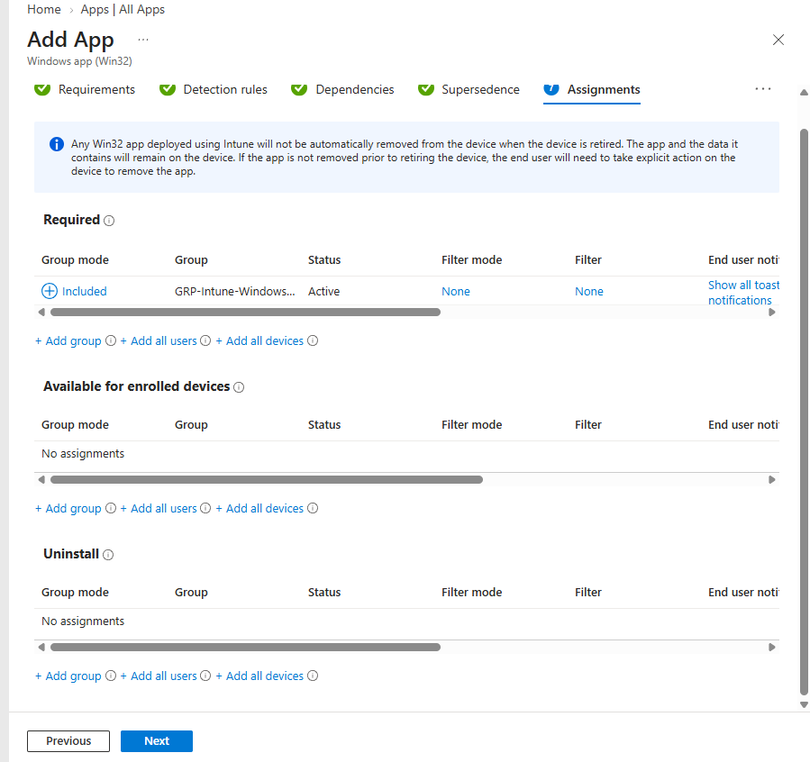

## 4. Endpoint security

Configured Microsoft Defender Antivirus, Windows Firewall (Domain / Private / Public profiles), and Attack Surface Reduction rules in Audit mode. Verified **Succeeded** status for Defender Antivirus and Firewall policies in the Intune device configuration report.

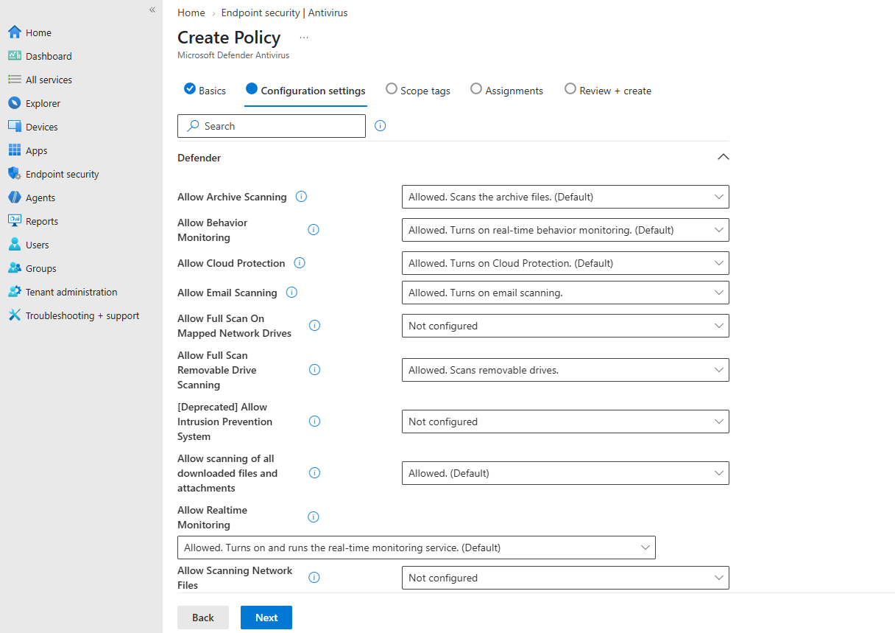
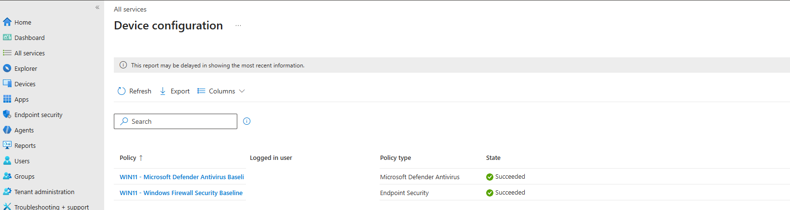
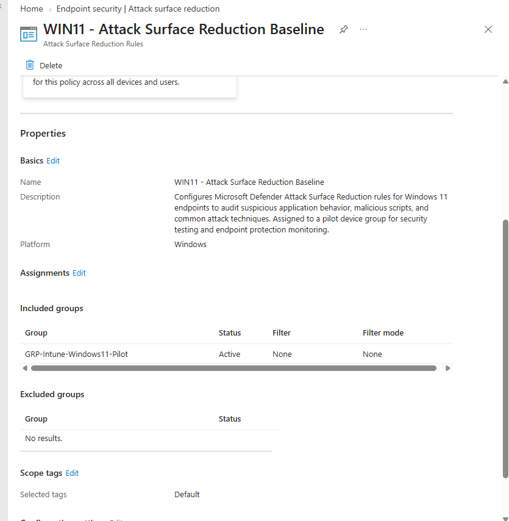

## 5. PowerShell automation

Created three Windows administration scripts:

| Script | Function |
|---|---|
| [Get-SystemInventory.ps1](scripts/Get-SystemInventory.ps1) | Captures Windows edition, version, hostname, RAM, free disk space; exports CSV |
| [Get-EndpointSecurityHealth.ps1](scripts/Get-EndpointSecurityHealth.ps1) | Checks Defender service, real-time protection, signatures, and firewall profiles; exports CSV |
| [Repair-WindowsService.ps1](scripts/Repair-WindowsService.ps1) | Detects stopped Print Spooler, attempts restoration, verifies status, exports CSV |

Scripts were **tested locally in the VM**. Sample report outputs are available in [`reports/`](reports/).

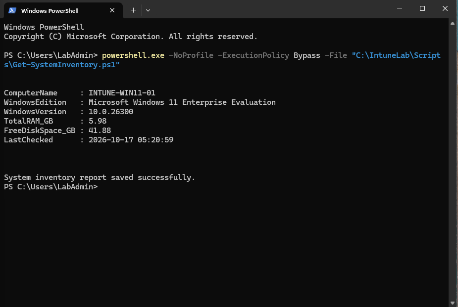
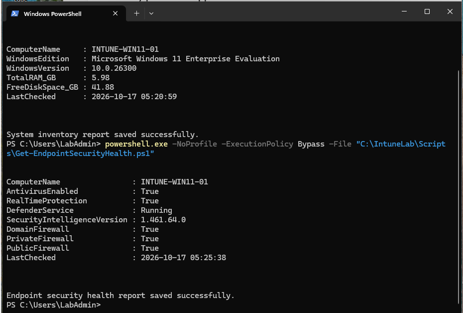

Read the [documented service-remediation scenario](docs/Service-Remediation-Case.md).

## Technologies and skills

Microsoft Intune · Microsoft Entra ID · Windows 11 Enterprise · Oracle VirtualBox · MDM enrollment · Compliance policies · Microsoft Defender Antivirus · Windows Firewall · Win32 packaging · Microsoft Store app assignments · PowerShell · CSV reporting · IT troubleshooting
