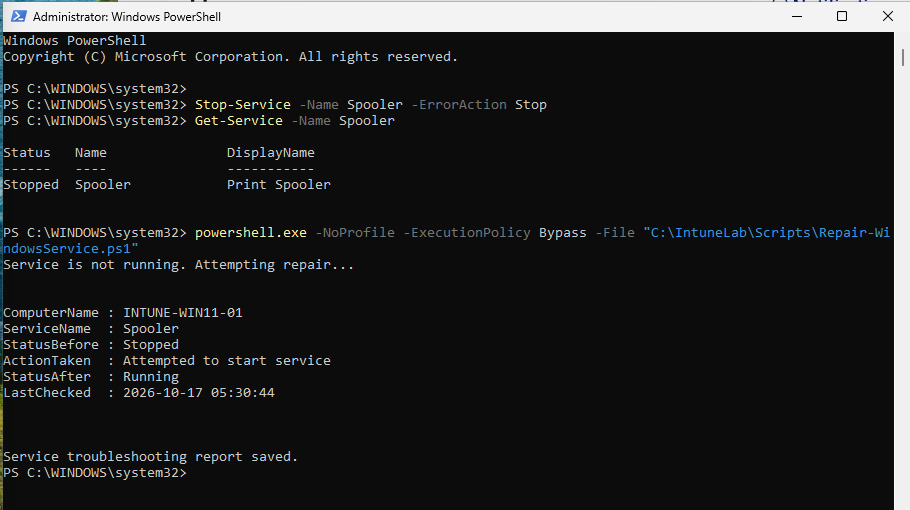

# Lab Incident: Print Spooler service restoration

**Device:** `INTUNE-WIN11-01`  
**Scenario:** Simulated print service interruption in an isolated Windows 11 VM.

## Procedure
1. Used elevated PowerShell to stop the `Spooler` service for the controlled test.
2. Confirmed service state was `Stopped` using `Get-Service -Name Spooler`.
3. Ran `Repair-WindowsService.ps1`.
4. Script detected the stopped service, executed `Start-Service`, and rechecked its status.
5. Confirmed `StatusBefore: Stopped` and `StatusAfter: Running`.
6. Exported results to `ServiceRemediation.csv`.

## Result
The local PowerShell script restored the Print Spooler service to running.

